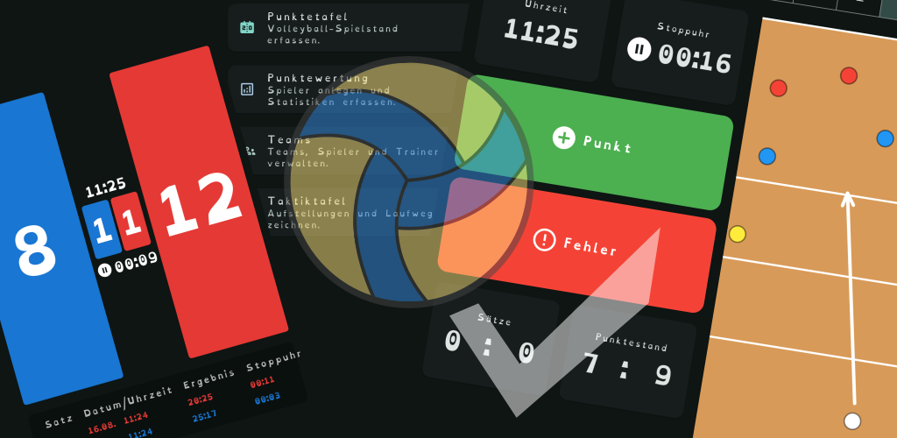

# VolleyAce

Volleyball Assistenz-App für Trainer, Spieler und Schiedsrichter.

- Punktetafel - Verlauf und Auswertungen, inkl. Stop-Uhr, Auszeiten
- Taktiktafel - Mehrere Seiten, speichern/teilen
- Teams - Spieler und Trainer verwalten, Teamstatistiken einsehen
- Training - Trainings durchführen, Teilnahme erfassen, Statistiken einsehen und Bewertungen erfassen
  - Trainingspläne - Trainingsabläufe mit Übungen zusammenstellen
  - Trainingsübungen - Einzelne Übungen verwalten und konfigurieren
- Punktewertung - Bewerten wie Punkte erzielt oder verloren werden



## Technologie

- [x] Flutter/Dart
  - [x] Android
  - [ ] Web Applikation (Notizen in simple present)
  - [x] Windows/Linux
- Lokaler Storage: Sembast
  - Datei: `volley_ace.db` auf Desktop/Android
  - IndexedDB im Web
  - Settings-Store: `settings`, Datensatz `app`
- [ ] Cloud Sync
- [ ] Anmeldung / Einladung
- [ ] Teams inkl. Berechtigungen
  - [ ] Mitglieder
  - [ ] Trainer
- [ ] Sprachsteuerung (insbesondere für die Punktetafel)
- [x] Bildschirm aktiv lassen
- [ ] Resposives Design

## Features

- [x] Punktetafel
  - [x] Punktestände importieren
  - Zwei farbige Satzpunkt-Anzeigen (blau/rot)
  - Gewonnene Sätze in der Mitte
  - Nach unten wischen: Punkt vergeben
  - Nach oben wischen: letzten Punkt zurücknehmen
  - Nach links/rechts wischen: Seiten, Farben und Spielstände tauschen
  - Satzgewinn automatisch ab 25 Punkten mit zwei Punkten Vorsprung
  - [x] Uhr / Stop-Uhr
    - [x] Stop-Uhr automatisch starten wenn erster Punkt vergeben wird (damit sie zumindest verzögert startet...)
    - Satzende pausiert die Uhr; die erste Punktbuchung des naechsten Satzes setzt sie fort, sofern sie nicht bereits laeuft. Das gilt auch fuer Fehlerbuchungen zugunsten des Gegners und fuer die Punktewertung. Die gemessene Zeit bleibt erhalten, Satzpausen werden nicht mitgezaehlt.
  - [x] Letzte Punkte pro Satz anzeigen
  - [x] Verlauf pro Satz anzeigen
  - [x] Auszeiten pro Team
        30 Sekunden Timer
        2 Stück pro Satz und Team
  - [x] Rotation / Spielerwechsel (optional)
    - [x] Spielinfos [Eingabe/Erfassung]
      - [x] Team A
        - [x] Team (optional)
        - [x] Spieler/Nummern
      - [x] Team B
        - [x] Team (optional)
        - [x] Spieler/Nummern
      - [x] Aufschlagteam
      - [x] Spielklasse auswählen (U12, U13, U14, U15, U16, U18, U20, Damen, Herren, Mixed, Freizeit)
            Rotation/Position muss je nach Spielklasse unterschiedlich sein!
            U12-U13: 3 Spieler, U14-U15: 4 Spieler, Rest: 6 Spieler
            U12-U15: Rotation nach 2 Aufschlägen und bei Aufschlagwechsel, Rest: Rotation nach Aufschlagwechsel
    - [x] WAS?
      - [x] Startaufstellung (Positionsnummern 1-6) [per D&D auf Spielfeld]
      - [x] Ersatzspieler
      - [x] Spielerwechsel
    - [x] Anzeige in einem Spielfeld auf den jeweiligen Positionen 1-6
          Bei Punktvergabe soll Rotation berücksichtigt werden, manuell soll aber auch eine Rotation ausgelöst werden können (falls ein Team außerhalb der Punkte-Rotation rotieren möchte)
- [x] Taktiktafel
  - [x] Speichern von Taktiken
  - [x] Taktiken importieren
  - [x] Mehrere Seiten pro Taktik
  - [x] Text-Notizen pro Seite
- [x] Spieler / Trainer
  - [x] Eigener Hauptmenüpunkt über Teams mit Personenliste nach ID
  - [x] Freitextfilter nach Person und/oder Mannschaft
  - [x] Spieler und Trainer zentral mit Name und Geburtsdatum pflegen
  - [x] Mannschaftsverknüpfungen anzeigen und passenden Team-Bereich direkt öffnen
  - [x] Personen ohne Mannschaft anlegen und einer Mannschaft zuordnen
  - [x] Trikotnummer, Position und Profile bleiben mannschaftsspezifisch
- [x] Team
  - [x] Info
    - [x] Teamname
    - [x] Teamlogo
    - [x] Teamfarben
    - [x] Spielklasse
    - [x] Teamprofil
    - [ ] Teamstatistik
    - [ ] Teambewertung
    - [ ] Achievements
  - [x] Spieler
    - [x] Trikotnummer
    - [x] Position
    - [x] Spielerprofil
    - [ ] Spielerstatistik
    - [x] Spielerstatistik
      - [x] Punktewertung
      - [ ] Trainingsstatistik
    - [ ] Trainingsteilnahme
    - [ ] Trainingsbewertungen
    - [ ] Trainingsstände
    - [ ] Achievements
  - [ ] Spielerbewertung
  - [x] Trainer
    - [x] Name
    - [x] Geburtsdatum / Alter
    - [x] Position
    - [x] Trainerprofil
    - [x] Trainerstatistik
    - [ ] Trainerbewertung
    - [ ] Achievements
  - [ ] Mannschaftskasse
- [x] Punktewertung
      Bewerten wie Punkte gemacht werden um eine Statistik zu Spielern und Teams zu erstellen.
      Es soll eine persistente Liste an Spielen geben, wird ein neues Spiel gestartet sollen die Spielinfos abgefragt werden.
      Wählt man ein Spiel aus, kann man entweder Punktewertung erfassen oder die Statistik einsehen.
  - [x] Spielinfos
        Abfragen beim Spielstart, um die Statistik zu speichern.
    - [x] Spielort
    - [x] Gegnerteam
    - [x] Spieltag / Datum (Heute) / Uhrzeit (Jetzt)
    - [x] Spieltyp (Liga, Turnier, Freundschaftsspiel, Trainingsspiel)
    - [x] Team / Spieler / Trainer
          Im Ersten Schritt pro Wertungsbogen Spieler (Name und Trikotnummer) mit + und - Buttons hinzufügen oder entfernen.
          Im zweiten Schritt Spieler aus dem Team welches vorab angelegt wird ausgewählt werden und die Punktewertung pro Spieler speichern.
    - [x] Spielklasse
  - [x] Punktewertung erfassen
    - [x] Punkt / Fehler
          Zwei Buttons Grün und Rot die je für Punkt / Fehler stehen und dann zur Abfrage des Spielers scrollen.
          Spielstand / Uhrzeit / Stopuhr
          - [x] Auszeiten pro Team anzeigen
          - [ ] Spielerwechsel pro Team anzeigen ?
          - [x] Rotation für unsere Spieler anzeigen
    - [x] Wertung
          - Punkte - Auswahl wie ein Punkt erreicht wurde.
            - Aufschlag
              - Ass
              - Netzroller
              - Scharf
              - Gegenfehler
              - Sonstiges
                - Text-Eingabe (Mit Auswahl letzter 10 Eingaben)
            - Angriff
              - Auge / Lücke
              - Angriffsschlag
              - Gegner Annahmefehler
              - Zuspieler-Finte
              - Netzroller
              - Glück
              - Sonstiges
                - Text-Eingabe (Mit Auswahl letzter 10 Eingaben)
            - Block
            - Gegnerfehler
            - Sonstiges
              - Text-Eingabe (Mit Auswahl letzter 10 Eingaben)
          - Fehler - Auswahl Welcher Fehler gemacht wurde.
            - Aufschlag
              - Ball ins **seitliche** Aus
              - Ball ins **hintere** Aus
              - Ball ins **Netz**
              - Ball **zu Kurz**
              - Übertritt
              - Sonstiges
                - Text-Eingabe (Mit Auswahl letzter 10 Eingaben)
            - Annahme
              - Zugeschaut
              - Absprache
              - Tusch
              - **Untere** Annahme
              - **Obere** Annahme
              - Sonstiges
                - Text-Eingabe (Mit Auswahl letzter 10 Eingaben)
            - Angriff
              - Ball ins **seitliche** Aus
              - Ball ins **hintere** Aus
              - Ball ins **Netz**
              - Ball **nicht rüber**
              - Hinterfeldangriff
              - Sonstiges
                - Text-Eingabe (Mit Auswahl letzter 10 Eingaben)
            - Zuspiel
              - Absprache
              - **Unteres** Zuspiel
              - **Oberes** Zuspiel
              - Sonstiges
                - Text-Eingabe (Mit Auswahl letzter 10 Eingaben)
            - Netz
              - Berührung
              - Übertritt
              - Sonstiges
                - Text-Eingabe (Mit Auswahl letzter 10 Eingaben)
            - Sonstiges
              - Text-Eingabe (Mit Auswahl letzter 10 Eingaben)
      - [x] Auszeit (wichtig für den Verlauf / Impact)
    - [x] Wer
          Spieler als Karte mit Name und Trikotnummer, die man nach oben oder unten scrollen kann, um den Spieler auszuwählen.
    - [x] Verlauf
    - [x] Statistik
      - [x] Spielstand
      - [x] Satzstand
      - [x] Punkte pro Art
      - [x] Fehler pro Art
      - [x] Diagram über Punkte/Fehler im Zeitverlauf
      - [x] Spieler
        - [x] Punkte / Fehler pro Spieler
        - [x] Punkte pro Art
        - [x] Fehler pro Art
        - [x] Diagram über Punkte/Fehler im Zeitverlauf
        - [ ] Aufklappbare Details pro Spieler
      - [ ] Export
        - [x] PDF inkl. Grafiken
        - [ ] Format das in Excel importiert werden kann
    - [x] Spielbericht
- [x] Training
  - [x] Training
    - [x] Mehrere Trainings speichern
    - [x] Trainings teilen
    - [x] Trainings importieren
    - [x] Infos
      - [x] Name
      - [x] Datum / Uhrzeit
      - [x] Ort
      - [x] Dauer
      - [x] Beschreibung
      - [x] Team
    - [x] Trainingsteilnahme (Trainer, Spieler)
      - [x] Teilnahme
        - [x] Manuell Trainer und Spieler hinzufügen
      - [x] Entschuldigt
      - [x] Unentschuldigt
    - [x] Trainingsplan mit Übungen, Sortierung, Abschluss und Überspringen
      - [x] Übungen
        - [x] Typ (Aufwärmen, Technik, Taktik, Spiel, Kraft, Ausdauer, Koordination, Dehnen, Cooldown)
        - [x] Ziel
        - [x] Dauer
        - [x] Beschreibung
    - [ ] Trainingsstatistik
    - [ ] Trainingsbewertung
  - [x] Trainingspläne
    - [x] Trainingsplan erstellen
      - [x] Thema
      - [x] Dauer
      - [x] Beschreibung
      - [x] Übungen aus den Trainingsübungen hinzufügen
      - [x] Übungen sortieren per D&D
    - [x] Import / Teilen von Trainingsplänen
    - [x] Trainingspläne kopieren und löschen
  - [x] Trainingsübungen
    - [x] Einzelne Übungen erstellen und konfigurieren
      - [x] Typ (Aufwärmen, Technik, Taktik, Spiel, Kraft, Ausdauer, Koordination, Dehnen, Cooldown)
      - [x] Ziel
      - [x] Dauer
      - [x] Beschreibung
    - [x] Import / Teilen von Trainingsübungen
    - [x] Trainingsübungen kopieren und löschen
    - [x] Filterung nach Typ, Name
- [ ] Volley-Arcade

## ToDo

- [x] Import / Export (Teams, Punktewertung, Taktiktafel)
  - [ ] Diff / import-Date vs. Änderungsdatum
- [ ] Diagramm mit Differenzpunkten?
- [ ] Punktetafel mit Trainingsübungen (Spiel) Verknüpfen (Teams/Spielerstatistik über Rotation möglich)
- [ ] Spieler/Trainer Statistik muss über alle Mannschaften hinweg möglich sein und angezeigt werden.
- [ ] satzende soll automatisch erkannt werden?!
- [ ] html export
- [x] linux installationsskript prüfen und ggf. anpassen.
- [x] gleichartige punkte highlighten, schlüsselwörter fett (siehe oben bei der punktewertungdefinition)
- [x] aufschlagspieler bei aufschlagpunkt direkt als markiert auswählen / highlighten
- [x] aufschlagspieler bzw. rotation muss manuell geändert werden können, wenn das schiedgericht ggf. vorher / mitten drin mist gemacht
- [x] buttons um notizen in die zeitleiste einzufügen während der punktewertung
- [?] start aufaufstellung satz muss noch mal aufrufbar sein
- [x] verlauf soll per Freitext nach Spieler, Punktart und Spielerwechsel filterbar sein
- [x] punktewertung übersicht als "graph" nach datum
- [x] filter für punkterwertung übersicht, nach z.b. gegner, spielort, spieler etc.
- [x] statistik meherer spiele soll wie beim export die spiel infos darstellen
- [x] im diagramm soll farblich dargestellt werden, in welchen sätzen bzw. zeiten der spieler auf dem feld war
- [x] filter als freitext-filter (einzelnes textfeld) umsetzten
- [x] punktewertung die startspieler in die hostorie schreiben
- [x] rotation in die hostorie schreiben (wichitg ist manuelle rotation und aufschlaganpassung historiesieren)
- [x] satzbeenden muss punkte 0en
- [x] kompletter export, und import mit "merge" Funktion
- [x] Export mit fortlaufendem A4-Kacheldruck und hartem Zuschnitt zum Zusammenkleben
- [x] Spielerstatus im Satzdiagramm einheitlich: grün auf dem Feld, gelb bei Kader/Bank, rot nur wenn nicht im Matchkader
- [x] Raster entfernen; Satzende mit kräftigem Strich, Spielende mit Doppelstrich; auch im PDF-Export
- [x] Statistik- und Exportdiagramme für Statusfarben und Markierungen angleichen
- [x] spiel als beendet markiern
- [x] statistik diagramme mehrere spiele sollen einmal ein diagram über alle selektierten spiele darstellen, also fortlaufend aggregiert und darunter soll ein diagram sein das pro spiel wieder bei 0 startet und rauf zählt, so dass man alle spiele direkt nebeneinander vergleichen kann. soll sowohl für den export, als auch für die statistik in app dargestellt werden.
- [x] punkte / fehler in der statistik als baum kaskadieren und nach oben summieren
  - [x] Spieler als Tabellenspalten, Punkte und Fehler als Zeilen je Baumknoten
  - [x] Summen von den Unterkategorien bis zu den Oberkategorien und Gesamt
  - [x] Baumdiagramm im Statistik- und Gesamtexport
- [ ] spieler / trainer sind die akchen noch seltsam designt

## Linux-Installation

Das Linux-Release entpacken und im entpackten Verzeichnis ausfuehren:

```bash
bash ./install-client.sh
```

Der Installer benoetigt Bash und `rsync`, aber weder Root-Rechte noch ein Flutter-SDK. Er installiert das fertige Bundle nach `~/.local/share/volleyace` und bietet Startmenue- und Desktop-Verknuepfungen an. Der Desktop-Ordner wird ueber `xdg-user-dir` ermittelt, falls verfuegbar. Bei Updates wird nach Bestaetigung die bisherige Installation unter einem eindeutigen `.bak.*`-Namen gesichert. Nutzerdaten bleiben unveraendert.

Aus dem Quellcode zuerst das Linux-Bundle bauen und dann installieren:

```bash
flutter build linux --release
bash deploy/install-client.sh
```

Ein anderes Bundle kann als erstes Argument uebergeben werden. Alternativ installiert `bash deploy/install-linux-desktop.sh` das gebaute Bundle ohne Rueckfragen nach `~/.local/opt/volleyace` und legt einen Startmenue-Eintrag an.

Zur Deinstallation im entpackten Release `bash ./uninstall-client.sh` ausfuehren; im Repository lautet der Aufruf `bash deploy/uninstall-client.sh`. Nach Bestaetigung werden Programmdateien, VolleyAce-Verknuepfungen und das App-Icon entfernt. Datenbank, Exporte und Update-Sicherungen bleiben erhalten.

Der isolierte Installationstest verwendet ein temporaeres HOME und ein Test-Bundle; er veraendert keine echte Installation:

```bash
bash test/linux_installation_test.sh
```

## PDF-Export und Dateinamen

Statistik und Gesamtexport bieten beim PDF-Export Baumdiagramme zu Punkten und Fehlern. Unterkategorien werden eingerueckt dargestellt; Oberkategorien und Gesamt enthalten jeweils die aufsummierten Werte. Die Statistiktabelle fuehrt Spieler als Spalten und Punkte beziehungsweise Fehler als Zeilen.

Statistik, Gesamtexport und Spielverlauf bieten beim PDF-Export drei Layouts:

- **Endlos (Bildschirm):** eine lange Seite ohne Seitenwechsel. Die Seitenhoehe richtet sich nach dem Inhalt; es wird kein pauschaler leerer Anhang angehaengt.
- **DIN A4 hoch (Druck):** Seite 1 mit Spielinfos sowie gruppiertem Punkte-/Fehler-Diagramm und Tabelle nach Hauptkategorie. Danach folgen Gesamt-Zeitverlauf, Spieluebersicht und Spieleruebersicht. Die Spieler-Zeitverlaeufe stehen auf eigenen Seiten mit maximal drei Spielern pro Seite; bei weniger Spielern wird die verfuegbare Hoehe auf deren Diagramme verteilt. Bei Mehrspielauswahl erhaelt jeder Spieler eine Seite mit Gesamtverlauf und darunter seinem Spielvergleich.
- **DIN A4 Kachel (zum Kleben):** Der fortlaufende Statistikbericht wird ohne Umbruch neu zu layouten in feste A4-Fenster aufgeteilt und an den Blattgrenzen hart abgeschnitten. Oben gibt es keinen Rand, seitlich und unten jeweils 0,5 cm; der untere Rand dient als Schnitt-/Klebekante.

Bei mehreren ausgewaehlten Spielen zeigen App und Statistikexport zuerst den fortlaufend aggregierten Zeitverlauf und darunter einen Spielvergleich. Auch unter dem jeweiligen Gesamtverlauf jedes Spielers steht ein eigener Spielvergleich. Im Vergleich beginnen Punkte, Fehler und Gegnerfehler je Partie bei 0; die Spiele stehen chronologisch in gleich breiten Abschnitten nebeneinander. Wie im Gesamtdiagramm stehen Gruen fuer Punkte, Rot fuer Fehler und Blau fuer Gegnerfehler.

Unterkategorien bleiben als separate Detailtabelle erhalten. Beide Layouts enthalten ausserdem Fehler pro Spieler nach Fehlerart mit Anzahl und Gesamtsumme; Spieler ohne Fehler werden mit 0 ausgewiesen. An den Spieler-Zeitverlaeufen stehen Punkte und Fehler zusaetzlich als Zahlen. Sehr grosse Kategorie- oder Uebersichtstabellen werden auf Folgeseiten fortgesetzt. Bei mehreren Partien folgen die Einzelberichte nach demselben Aufbau; Spielbericht und Verlauf bleiben im Gesamtexport enthalten.

PDFs haben feste Seitenformate. Eine endlose Seite kann beim normalen Drucken nicht automatisch in A4-Seiten umgebrochen werden; manche Reader bieten dafuer einen Poster-/Kacheldruck. Fuer verlaessliches Drucken das A4-Layout waehlen. Ein A4-PDF kann im Reader trotzdem in einer fortlaufenden Scrollansicht gelesen werden, hat aber weiterhin Seitengrenzen.

Spiel-Exporte beginnen mit Datum und Uhrzeit des chronologisch ersten ausgewaehlten Spiels, danach folgen dessen Standort und die Gegnerteams in Spielreihenfolge (ohne doppelte Namen). Dies gilt fuer einzelne und mehrere Spiel-Backups sowie fuer PDFs. PDF-Namen enden zusaetzlich mit Exporttyp und Layout, zum Beispiel:

`2026-10-27_18-30_sporthalle_team-rot_team-blau_statistik_a4-hoch.pdf`

## Datenschutz

Volley Ace speichert Teams, Spieler, Trainingsdaten, Taktiken, Spielstaende und Statistiken lokal auf dem Geraet. Es gibt derzeit keine Cloud-Synchronisierung und keine automatische Serveruebertragung. Details stehen in `PRIVACY.md`.

## Rechtliches

Der Source Code steht unter MIT-Lizenz. Name, Logo, Icons und sonstige Brand Assets sind separat geschuetzt. Details stehen in `LICENSE`, `TRADEMARK.md` und `THIRD_PARTY_LICENSES.md`.

## footnote

Developed with the kind support of Copilot