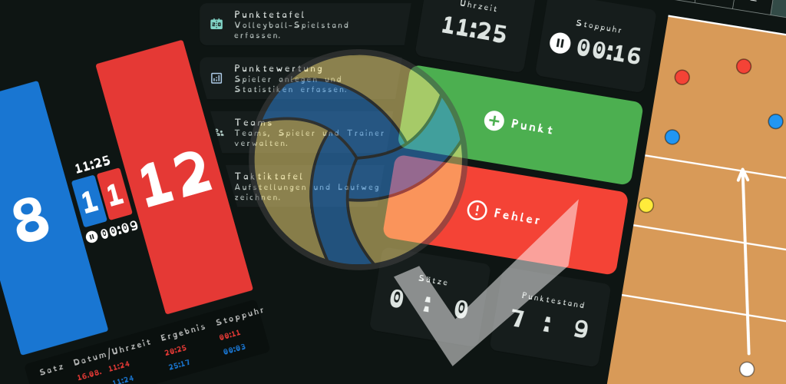

# VolleyAce

Volleyball Assistenz-App für Trainer, Spieler und Schiedsrichter.

- Punktetafel - Verlauf und Auswertungen, inkl. Stop-Uhr, Auszeiten
- Taktiktafel - Mehrere Seiten, speichern/teilen
- Teams - Spieler und Trainer verwalten, Teamstatistiken einsehen
- Training - Trainings durchführen, Teilnahme erfassen, Statistiken einsehen und Bewertungen erfassen
  - Trainingspläne - Trainingsabläufe mit Übungen zusammenstellen
  - Trainingsübungen - Einzelne Übungen verwalten und konfigurieren
- Punktewertung - Bewerten wie Punkte erzielt oder verloren werden

## Technologie

- [x] Flutter/Dart
  - [x] Android
  - [ ] Web Applikation (Notizen in simple present)
  - [x] Windows/Linux
- Lokaler Storage: Sembast
  - Datei: `volley_ace.db` auf Desktop/Android
  - IndexedDB im Web
  - Settings-Store: `settings`, Datensatz `app`
- [ ] Cloud Sync
- [ ] Anmeldung / Einladung
- [ ] Teams inkl. Berechtigungen
  - [ ] Mitglieder
  - [ ] Trainer
- [ ] Sprachsteuerung (insbesondere für die Punktetafel)
- [x] Bildschirm aktiv lassen
- [ ] Resposives Design

## Features

- [x] Punktetafel
  - [x] Punktestände importieren
  - Zwei farbige Satzpunkt-Anzeigen (blau/rot)
  - Gewonnene Sätze in der Mitte
  - Nach unten wischen: Punkt vergeben
  - Nach oben wischen: letzten Punkt zurücknehmen
  - Nach links/rechts wischen: Seiten, Farben und Spielstände tauschen
  - Satzgewinn automatisch ab 25 Punkten mit zwei Punkten Vorsprung
  - [x] Uhr / Stop-Uhr
    - [x] Stop-Uhr automatisch starten wenn erster Punkt vergeben wird (damit sie zumindest verzögert startet...)
  - [x] Letzte Punkte pro Satz anzeigen
  - [x] Verlauf pro Satz anzeigen
  - [x] Auszeiten pro Team
        30 Sekunden Timer
        2 Stück pro Satz und Team
  - [x] Rotation / Spielerwechsel (optional)
    - [x] Spielinfos [Eingabe/Erfassung]
      - [x] Team A
        - [x] Team (optional)
        - [x] Spieler/Nummern
      - [x] Team B
        - [x] Team (optional)
        - [x] Spieler/Nummern
      - [x] Aufschlagteam
      - [x] Spielklasse auswählen (U12, U13, U14, U15, U16, U18, U20, Damen, Herren, Mixed, Freizeit)
            Rotation/Position muss je nach Spielklasse unterschiedlich sein!
            U12-U13: 3 Spieler, U14-U15: 4 Spieler, Rest: 6 Spieler
            U12-U15: Rotation nach 2 Aufschlägen und bei Aufschlagwechsel, Rest: Rotation nach Aufschlagwechsel
    - [x] WAS?
      - [x] Startaufstellung (Positionsnummern 1-6) [per D&D auf Spielfeld]
      - [x] Ersatzspieler
      - [x] Spielerwechsel
    - [x] Anzeige in einem Spielfeld auf den jeweiligen Positionen 1-6
          Bei Punktvergabe soll Rotation berücksichtigt werden, manuell soll aber auch eine Rotation ausgelöst werden können (falls ein Team außerhalb der Punkte-Rotation rotieren möchte)
- [x] Taktiktafel
  - [x] Speichern von Taktiken
  - [x] Taktiken importieren
  - [x] Mehrere Seiten pro Taktik
  - [x] Text-Notizen pro Seite
- [x] Team
  - [x] Info
    - [x] Teamname
    - [x] Teamlogo
    - [x] Teamfarben
    - [x] Spielklasse
    - [x] Teamprofil
    - [ ] Teamstatistik
    - [ ] Teambewertung
    - [ ] Achievements
  - [x] Spieler
    - [x] Name
    - [x] Trikotnummer
    - [x] Geburtsdatum / Alter
    - [x] Position
    - [x] Spielerprofil
    - [x] Spielerstatistik
      - [ ] Punktewertung
      - [ ] Trainingsstatistik
    - [ ] Spielerbewertung
    - [ ] Trainingsteilnahmepdf export verbessern (z.B. Layout, Formatierung) (fortlaufend ohne seitenumbruch?)

    - [ ] Trainingsbewertungen
    - [ ] Trainingsstände
    - [ ] Achievements
  - [x] Trainer
    - [x] Name
    - [x] Geburtsdatum / Alter
    - [x] Position
    - [x] Trainerprofil
    - [x] Trainerstatistik
    - [ ] Trainerbewertung
    - [ ] Achievements
- [x] Punktewertung
      Bewerten wie Punkte gemacht werden um eine Statistik zu Spielern und Teams zu erstellen.
      Es soll eine persistente Liste an Spielen geben, wird ein neues Spiel gestartet sollen die Spielinfos abgefragt werden.
      Wählt man ein Spiel aus, kann man entweder Punktewertung erfassen oder die Statistik einsehen.
  - [x] Spielinfos
        Abfragen beim Spielstart, um die Statistik zu speichern.
    - [x] Spielort
    - [x] Gegnerteam
    - [x] Spieltag / Datum (Heute) / Uhrzeit (Jetzt)
    - [x] Spieltyp (Liga, Turnier, Freundschaftsspiel, Trainingsspiel)
    - [x] Team / Spieler / Trainer
          Im Ersten Schritt pro Wertungsbogen Spieler (Name und Trikotnummer) mit + und - Buttons hinzufügen oder entfernen.
          Im zweiten Schritt Spieler aus dem Team welches vorab angelegt wird ausgewählt werden und die Punktewertung pro Spieler speichern.
    - [x] Spielklasse
  - [x] Punktewertung erfassen
    - [x] Punkt / Fehler
          Zwei Buttons Grün und Rot die je für Punkt / Fehler stehen und dann zur Abfrage des Spielers scrollen.
          Spielstand / Uhrzeit / Stopuhr
          - [x] Auszeiten pro Team anzeigen
          - [ ] Spielerwechsel pro Team anzeigen ?
          - [x] Rotation für unsere Spieler anzeigen
    - [x] Wertung
          - Punkte - Auswahl wie ein Punkt erreicht wurde.
            - Aufschlag
              - Ass
              - Netzroller
              - Scharf
              - Gegenfehler
            - Angriff
              - Auge / Lücke
              - Angriffsschlag
              - Gegner Annahmefehler
              - Zuspieler-Finte
              - Netzroller
            - Block
            - Gegnerfehler
            - Sonstiges
              - Text-Eingabeb (Mit Auswahl letzter 10 Eingaben)
          - Fehler - Auswahl Welcher Fehler gemacht wurde.
            - Aufschlag
              - Ball ins seitliche Aus
              - Ball ins hintere Aus
              - Ball ins Netz
              - Ball zu Kurz
              - Übertritt
            - Annahme
              - Zugeschaut
              - Tusch
              - Untere Annahme
              - Obere Annahme
            - Angriff
              - Ball ins seitliche Aus
              - Ball ins hintere Aus
              - Ball ins Netz
              - Ball nicht rüber
              - Hinterfeldangriff
            - Netz
              - Berührung
              - Übertritt
            - Sonstiges
              - Text-Eingabe (Mit Auswahl letzter 10 Eingaben)
      - [x] Auszeit (wichtig für den Verlauf / Impact)
    - [x] Wer
          Spieler als Karte mit Name und Trikotnummer, die man nach oben oder unten scrollen kann, um den Spieler auszuwählen.
    - [x] Verlauf
    - [x] Statistik
      - [x] Spielstand
      - [x] Satzstand
      - [x] Punkte pro Art
      - [x] Fehler pro Art
      - [x] Diagram über Punkte/Fehler im Zeitverlauf
      - [x] Spieler
        - [x] Punkte / Fehler pro Spieler
        - [x] Punkte pro Art
        - [x] Fehler pro Art
        - [x] Diagram über Punkte/Fehler im Zeitverlauf
        - [ ] Aufklappbare Details pro Spieler
      - [ ] Export
        - [x] PDF inkl. Grafiken
        - [ ] Format das in Excel importiert werden kann
    - [ ] Spielbericht
- [x] Training
  - [x] Training
    - [x] Mehrere Trainings speichern
    - [x] Trainings teilen
    - [x] Trainings importieren
    - [x] Infos
      - [x] Name
      - [x] Datum / Uhrzeit
      - [x] Ort
      - [x] Dauer
      - [x] Beschreibung
      - [x] Team
    - [x] Trainingsteilnahme (Trainer, Spieler)
      - [x] Teilnahme
        - [x] Manuell Trainer und Spieler hinzufügen
      - [x] Entschuldigt
      - [x] Unentschuldigt
    - [x] Trainingsplan mit Übungen, Sortierung, Abschluss und Überspringen
      - [x] Übungen
        - [x] Typ (Aufwärmen, Technik, Taktik, Spiel, Kraft, Ausdauer, Koordination, Dehnen, Cooldown)
        - [x] Ziel
        - [x] Dauer
        - [x] Beschreibung
    - [ ] Trainingsstatistik
    - [ ] Trainingsbewertung
  - [x] Trainingspläne
    - [x] Trainingsplan erstellen
      - [x] Thema
      - [x] Dauer
      - [x] Beschreibung
      - [x] Übungen aus den Trainingsübungen hinzufügen
      - [x] Übungen sortieren per D&D
    - [x] Import / Teilen von Trainingsplänen
    - [x] Trainingspläne kopieren und löschen
  - [x] Trainingsübungen
    - [x] Einzelne Übungen erstellen und konfigurieren
      - [x] Typ (Aufwärmen, Technik, Taktik, Spiel, Kraft, Ausdauer, Koordination, Dehnen, Cooldown)
      - [x] Ziel
      - [x] Dauer
      - [x] Beschreibung
    - [x] Import / Teilen von Trainingsübungen
    - [x] Trainingsübungen kopieren und löschen
    - [x] Filterung nach Typ, Name
- [ ] Volley-Arcade

## ToDo

- [x] Toast ist weiß!
- [x] Landscape Modus Punktetafel soll automatisch Zoom machen (Pinch to Zoom entfernen)
- [x] Icon (z.B. taskbar)
- [x] Settings auf deutsch
- [-] Sportschrift
- [x] Appname aktuell mit unterstich
- [x] Import / Export (Teams, Punktewertung, Taktiktafel)
  - [ ] Diff / import-Date vs. Änderungsdatum
- [x] Farbe rosa in die App übernehmen?
      -> Nehme doch das hellblau/mint
- [x] Verlaufdarstellung wie einen Versionsgraphen
- [x] Zurück Geste soll nur eine Seite zurück gehen
- [x] Weitere Trainer in der Punktewertung optional hinzufügen
- [x] Button für Spieler hinzufügen in der Punktewertung ist vollflächig Rot.
- [x] Sicherheitsabfrage vor löschen
- [x] 2.Highlight-Color für Buttons Auswählbar, per default alles Orange
- [x] Punktewertung soll "Punktewertung" und nicht "match" als Namenhint
- [x] Taktiktafel
  - [x] Touch Button
  - [x] Optional Nummern auf den Punkten
  - [x] Button-Liste 2 Zeilig wenn der Platz nicht reicht und Überschrift entfernen
- [x] Punktetafel Verlauf wird nicht korrekt geteilt (nach Import hab ich nur 1 Satz!)
      -> Nein, Sätze werden im Verlauf nicht korrekt gespeichert/angezeigt!
- [x] Teams-Kachel vorne das Teams Icon in den Farben des Teams
- [x] Training-Kachel vorne das Trainings Icon
- [x] Trainingsplan-Kachel vorne das Trainingsplan Icon
- [x] Punktewertung-Kachel vorne das Punktewertung Icon
- [x] Taktiktafel mit Trainingsübungen Verknüpfen
- [x] Aktives bzw. nächstes Training / Punktewertung auf Startseite anzeigen
- [x] Im Training mehrere Mannschaften hinzufügen (wenn U13 und U15 z.B. zusammen trainieren)
- [x] Buttons in Burgermenü
- [x] Training sortieren nach Datum desc
- [x] Spieler/Trainer als "Objekt" anlegen, so dass sie zwischen Mannschaften verschieben und mehrfach zuordnen kann
- [x] Trainingsplan im Training individuell anpassen (Übungen überspringen, Dauer ändern, Reihenfolge ändern, Weitere Übungen hinzufügen (manuell und aus dem Katalog))
- [x] Wählt man in der Punktewertung Punkt/Fehler aus, kann man nicht abbrechen. Zurück geht einfach Weiter!
- [x] Manuelles Satz beenden in der Punktewertung, wenn man z.B. nur bis 13 spielt!
- [x] Tooltipps oder Spielerseite in der ersichtlich ist wo der User alles verlinkt ist.
- [x] Spielernummern mit anzeigen
- [x] Bänke benennen (Team)
- [x] Wird ein Team mit gesetztem Spielbetrieb ausgewählt, soll der Spieltyp oben angepasst werden.
- [x] Punkte weiter nach hinten und kleiner
- [x] Mannschaftsauswahl und Spielklasse in eiegene Seite packe, so das Spielfeld nach eingabe oben
- [x] Button zum Aufruf oben Mittig!
- [x] Speichern/Abbrechen Button nach oben in die Leiste
- [x] Zurücksetzen soll auch Spieler zurücksetzen
- [x] Tests dauern ewig?!
- [x] Button muss etwas höher und sollte nicht doppelt sein (wird in Leiste oben angezeigt und unten)
- [x] Spielinfos (Mannschaft, Spielklasse) soll als zweite Seite aufrufbar sein, primäre Seite soll das Spielfeld sein!
- [x] Spieler nicht per D&D rein ziehen, sondern auf die Position auf dem Spielfeld tippen und dann eine Auswahl bekommen
- [x] Spielernummern müssen auch bei Mannschaften noch änderbar/eintragbar sein (Spielernummern können ggf. nicht fix sein!)
- [x] tagesstatistik / multistatistik
- [x] sortierung der punktewertungen nach eingetragener spiel uhrzeit!
- [ ] Diagramm mit Differenzpunkten?
- [ ] Punktetafel mit Trainingsübungen (Spiel) Verknüpfen (Teams/Spielerstatistik über Rotation möglich)
- [ ] Spieler/Trainer Statistik muss über alle Mannschaften hinweg möglich sein und angezeigt werden.
- [x] satz beenden geht nicht
- [x] editieren, auswechseln von spielern geht nicht (button zum editieren verschindet?!)
- [x] spieler im feld beim buchen anbieten, bank nicht zur auswahl anbieten
- [x] undefiniert und mannschaft als spieler zum buchen auswählen (wenn man es nicht eindeutig ist)
- [x] rückgängig machen von der letzten wertung (wertung um wertung) inkl. rotation!
- [x] zweite aufstellung (sitenwechsel rechts/links) fehler in der platz nummerierung bzw. plätze, platz 1 ist immer hinten rechts! d.h. auf der rechten seite muss platz 1 hinten rechts oben sein.
- [x] wird rechts als spielfeld in der punktewertung ausgewählt, wird das nicht gespeichert! soll aber gespeichert werden!
- [x] spielernummern werden nicht gespeichert
- [x] spielernummern aus mannschaft übernehmen (nachträglich!)
- [x] neuer baum zum buchen von spielpunkten (siehe oben)
  - [x] Annahmefehler
  - [x] aufschlagpunkt
- [x] automatisches buchen wenn kein spieler oder weitere option ausgewählt wird.
- [x] gegnerfehler im diagramm (dritte linie)
- [x] multistatistik
  - [x] Aufslistun ausgewählten partien
  - [x] im diagramm die partien im wechsel farblich hinterlegen
- [x] diagramme zoomen und scrollen können
- [x] multiexport und import!
- [x] gegnerfehler nur in der gesamtstatistik der mannschaft anzeigen, nicht bei den einzelspielern.
- [x] nachträgliches editieren von statistiken (punkte zuordnung z.B.)
- [x] diagramme zoom nur von der zeitachse und scrollen in der horiziontal achse
- [x] pdf export optional hoch- und querformat
- [x] diagram "punkte und fehler nach art" balkenbreiter
- [x] multiexport der statistik soll auch jede einzelstatistik pro punkterwertung in den export hinten dran hängen
- [ ] seitenwechsel in punktewertung ist nicht korrekt umgesetzt
- [x] automatisches buchen nach zeit klappt noch nicht, wird hauptkategorie gewählt, aber dann nicht weiter, soll auf unbekannt gebucht werden. wird spieler aber nicht spezifiziert, soll nur hauptkategorie gebucht werden. timeout auf 7 sekunden setzten.
- [x] rückgängig ist umgesetzt, ich brauche aber noch wiederholen (strg+z bzw. strg+y)
- [ ] satzende soll automatisch erkannt werden?!
- [x] diagramm zoom soll nicht einfach zoom sein! sondern die zeitachse sich nach rechts ausdehnen! also länger nach rechts werden
- [x] sonstiges, auswahl der letzten eingabe wird nicht angeboten
- [x] annahmefehler das "fehler" rausnehmen
- [x] pdf export verbessern (z.B. Layout, Formatierung) (fortlaufend ohne erzwungene seitenumbrüche zwischen partien)
- [x] bei der punktewertung erst hauptkategorie auswählen, dann spieler buchen und dann spezifizieren?! (wegen timeout)
- [x] diagramm bei multiselect zusammen dampfen, die zeiträume, in der kein spiel war, ausschneiden
- [x] Teilen aus 3 Punkte entfernen, wie löschen als Menüpunkt
- [ ] html export
- [x] pdf ohne seitenumbrüche
- [x] balkenbreite bei "punkte und fehler nach art" (viel) breiter!!
- [ ] "punkte und fehler nach art" auch als tabelle (zusätlich!) als tabelle exportieren

## Datenschutz

Volley Ace speichert Teams, Spieler, Trainingsdaten, Taktiken, Spielstaende und Statistiken lokal auf dem Geraet. Es gibt derzeit keine Cloud-Synchronisierung und keine automatische Serveruebertragung. Details stehen in `PRIVACY.md`.

## Rechtliches

Der Source Code steht unter MIT-Lizenz. Name, Logo, Icons und sonstige Brand Assets sind separat geschuetzt. Details stehen in `LICENSE`, `TRADEMARK.md` und `THIRD_PARTY_LICENSES.md`.

## footnote

Developed with the kind support of Copilot